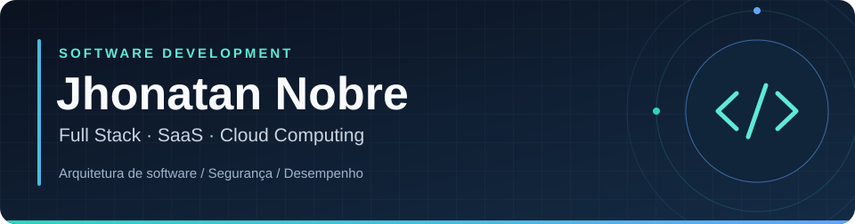

  
    
  
  

## 01 · Sobre mim

Desenvolvedor de software, formado em **Análise e Desenvolvimento de Sistemas pelo IFMS** e graduando em **Licenciatura em Computação pela UEMS**.

Atuo no desenvolvimento de aplicações web e soluções digitais, com foco em arquitetura de software, integração de sistemas, segurança, desempenho e eficiência operacional. Valorizo o aprendizado contínuo, a qualidade do código e a aplicação prática da tecnologia.

## 02 · Stack tecnológica

**Front-end**

  
  
  
  
  

**Back-end e dados**

  
  
  
  
  

**Infraestrutura e versionamento**

  
  
  
  
  
  

## 03 · Formação acadêmica

| Formação | Instituição | Situação |
| :--- | :--- | :--- |
| Análise e Desenvolvimento de Sistemas | IFMS | Concluído |
| Licenciatura em Computação | UEMS | Em andamento |

## 04 · Projetos públicos

<table width="100%">
  <tr>
    <td>
      <h3><a href="https://github.com/JhonatanNobreBarboza/aprendizado-visualg">Aprendizado Visualg</a></h3>
      
Repositório educacional dedicado à lógica de programação e ao desenvolvimento de algoritmos.

      
    </td>
  </tr>
</table>

[Explorar todos os repositórios públicos](https://github.com/JhonatanNobreBarboza?tab=repositories)

## 05 · Áreas de interesse

| Engenharia de software | Cloud e SaaS |
| :--- | :--- |
| Arquitetura, qualidade de código e integração de sistemas | Produtos digitais e infraestrutura em nuvem |
| **Segurança e desempenho** | **Educação tecnológica** |
| Otimização e boas práticas de desenvolvimento | Aprendizado contínuo e código aberto |

## 06 · Atividade no GitHub

[Consultar histórico de contribuições](https://github.com/JhonatanNobreBarboza#contribution-activity)

## 07 · About me

Brazilian software developer focused on full-stack web development, SaaS and cloud computing, with an interest in software architecture, performance, security and technology education.

---

  <strong>Tecnologia aplicada à solução de problemas reais.</strong>

